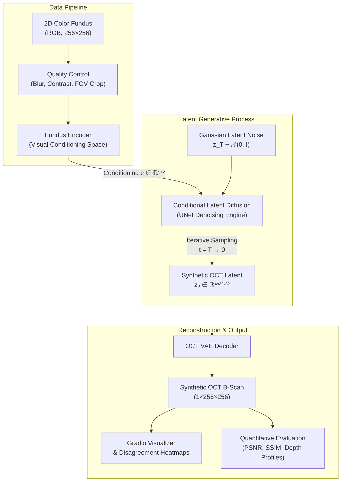

# Fundus2OCT: Generative AI Architecture & Research Prototype

Exploring Cross-Modality Retinal Synthesis: Generating 3D Optical Coherence Tomography (OCT) Volumes and 2D B-Scans from 2D Color Retinal Fundus Photographs via Conditional Latent Diffusion.

[](https://www.python.org/)
[](https://pytorch.org/)
[](https://gradio.app/)
[](#disclaimer)

---

> [!CAUTION]
> **RESEARCH PROTOTYPE — NOT A CLINICAL DIAGNOSTIC DEVICE**
> All outputs generated by this system are **SYNTHETIC — NOT A REAL OCT MEASUREMENT**. They represent stochastic computational hypotheses synthesized by generative neural networks and must **never** be used for clinical diagnosis, patient management, or treatment decisions.

---

## 1. Research Overview & Background

Optical Coherence Tomography (OCT) provides micron-resolution, cross-sectional volumetric views of retinal layers (e.g., ILM, RNFL, RPE, and choroid), making it indispensable for diagnosing Age-Related Macular Degeneration (AMD), Diabetic Retinopathy (DR), and Glaucoma. However, OCT devices are bulky, expensive, and largely restricted to specialized tertiary ophthalmic clinics. In contrast, 2D color fundus cameras are widely deployed, portable, and accessible in primary care.

**Fundus2OCT** implements the architecture proposed in recent generative ophthalmology literature (*"Generating 3D Optical Coherence Tomography from 2D Fundus Images via Diffusion Models"*). It bridges the modality gap by learning a conditional mapping:

$$\text{Fundus Image } (2D) \longrightarrow \text{Latent Diffusion Model } p_\theta(z_0 \mid c) \longrightarrow \text{Synthetic OCT B-Scan / 3D Volume}$$

---

## 2. System Architecture & Dataflow



### Key Dimensional Contracts
- **Fundus Input**: `(B, 3, 256, 256)` float tensor normalized to ImageNet statistics or unit range.
- **Conditioning Embedding ($c$)**: `(B, 512)` semantic embedding extracted from retinal vessels, fovea, and optic disc.
- **OCT Latent Space ($z$)**: `(B, 4, 32, 32)` 8× spatially compressed continuous latent space via trained OCT VAE.
- **OCT Output ($x$)**: `(B, 1, 256, 256)` cross-sectional B-scan in `[-1.0, 1.0]` normalized space.

---

## 3. Project Directory Structure

```text
Fund2Oct/
├── app.py                                   # Gradio Web UI (5 interactive research tabs)
├── configs/
│   └── default.yaml                         # Centralized configuration (paths, models, training)
├── requirements.txt                         # Windows-friendly pinned dependencies
├── README.md                                # Research documentation and setup guide
├── .gitignore                               # Git exclusions for datasets, weights, venvs
├── src/
│   └── fundus2oct/
│       ├── __init__.py                      # Package initialization
│       ├── config.py                        # Strongly-typed dataclasses & YAML parser
│       ├── data/
│       │   ├── preprocessing.py             # Safe loading, FOV cropping, normalization
│       │   ├── quality_control.py           # Sharpness, dynamic range, illumination screening
│       │   ├── pairing.py                   # Patient-level pairing and split stratification
│       │   └── dataset.py                   # PyTorch Paired and Reconstruction Datasets
│       ├── models/
│       │   ├── oct_vae.py                   # 2D/3D OCT Variational Autoencoder
│       │   ├── fundus_encoder.py            # Retinal feature extractor (CNN / EyeFound stub)
│       │   ├── conditional_diffusion.py     # Conditional Latent Diffusion UNet
│       │   ├── pipeline.py                  # End-to-end Fundus2OCT Pipeline coordinator
│       │   ├── classifier_fundus.py         # Fundus-only AMD disease classifier
│       │   └── classifier_multimodal.py     # Joint Fundus + OCT diagnostic classifier
│       ├── inference/
│       │   ├── generate_oct.py              # High-level inference pipeline
│       │   └── candidates.py                # Multi-candidate stochastic sampling
│       ├── evaluation/
│       │   ├── metrics.py                   # PSNR, SSIM, MAE, MSE with spatial verification
│       │   ├── compare_models.py            # Comparative evaluation framework
│       │   ├── fid_fvd.py                   # Distributional distance metrics (FID/FVD)
│       │   └── uncertainty.py               # Disagreement analysis across candidate samples
│       └── visualization/
│           ├── oct_viewer.py                # Clinical B-scan visualizer with colormaps
│           ├── disagreement.py              # Candidate variation heatmap overlays
│           ├── volume_3d.py                 # Multi-planar 3D volume orthogonal viewer
│           └── segmentation.py              # Retinal layer boundary visualization
├── scripts/
│   ├── inspect_dataset.py                   # Kaggle dataset downloader & inspection tool
│   ├── validate_pairs.py                    # Dataset pairing and patient-leakage validator
│   ├── train_vae.py                         # OCT VAE reconstruction training script
│   ├── train_diffusion.py                   # Conditional latent diffusion training script
│   ├── train_classifiers.py                 # Baseline disease classifier training
│   ├── evaluate_generation.py               # Quantitative generative benchmark evaluation
│   └── evaluate_classifiers.py              # Downstream classification diagnostic evaluation
├── tests/
│   ├── test_preprocessing.py                # Preprocessing and QC unit tests
│   ├── test_pairing.py                      # Patient-leakage and pairing integrity tests
│   ├── test_shapes.py                       # Tensor dimension verification through all models
│   └── test_generation.py                   # Pipeline and missing-checkpoint error tests
├── data/
│   ├── fundus/                              # Retinal fundus image storage (.gitkeep)
│   ├── oct/                                 # OCT B-scans / volume storage (.gitkeep)
│   └── manifests/                           # Dataset CSV manifests (dataset.csv)
├── checkpoints/                             # Model weights directory (.gitkeep)
└── outputs/
    ├── synthetic_oct/                       # Exported generated OCT images (.gitkeep)
    ├── evaluation_reports/                  # Quantitative CSV evaluation summaries (.gitkeep)
    └── demo_assets/                         # Reference demonstration assets (.gitkeep)
```

---

## 4. Windows Setup & Installation

The project is fully tested on Windows 10/11 using PowerShell and supports **Python 3.12 through Python 3.14**.

### Step 1: Open PowerShell and Navigate to Workspace
```powershell
Set-Location -Path "d:\Fund2Oct"
```

### Step 2: Create a Virtual Environment

You can use the standard Python `venv` module or the fast `uv` toolchain:

**Option A — Using `uv` (Recommended):**
```powershell
uv venv .venv --python 3.14
.\.venv\Scripts\Activate.ps1
```

**Option B — Using standard Python:**
```powershell
python -m venv .venv
.\.venv\Scripts\Activate.ps1
```

> *Tip: If PowerShell displays an execution policy error, enable local script execution with:*  
> `Set-ExecutionPolicy -Scope Process -ExecutionPolicy Bypass`

### Step 3: Install PyTorch

- **For CPU Only (Development, Testing, and Inspection):**
  ```powershell
  uv pip install torch torchvision --index-url https://download.pytorch.org/whl/cpu
  ```
- **For NVIDIA GPU (CUDA 12.x for Accelerated Diffusion Training):**
  ```powershell
  uv pip install torch torchvision --index-url https://download.pytorch.org/whl/cu121
  ```

### Step 4: Install Project Dependencies
```powershell
uv pip install -r requirements.txt
```

---

## 5. Running the Pipeline & Workflows

### A. Download & Inspect the Kaggle Dataset
Automates downloading the Kaggle combined ARMD dataset (`saketlad/armd-combined-dataset-fundus-and-oct`), extracts fundus/OCT modalities, checks resolutions, and builds the pairing manifest:
```powershell
python scripts/inspect_dataset.py
```
*To inspect an already-downloaded local folder without re-downloading:*
```powershell
python scripts/inspect_dataset.py --skip-download
```

### B. Validate Pairing & Verify Zero Patient Leakage
Validates the pairing manifest to ensure that no patient appears across multiple splits (preventing train/val/test data leakage):
```powershell
python scripts/validate_pairs.py --manifest data/manifests/dataset.csv
```

### C. Run the Test Suite
Execute automated unit tests covering image preprocessing, QC screening, pairing exclusivity, and tensor dimension contracts:
```powershell
pytest -v tests/
```

### D. Train the OCT VAE Reconstruction Baseline
Train the 8× spatial compression Variational Autoencoder on OCT B-scans:
```powershell
python scripts/train_vae.py --config configs/default.yaml --epochs 50 --batch-size 8
```

### E. Launch the Gradio Web Application
Launch the interactive web interface locally:
```powershell
python app.py
```
Open your browser at: `http://127.0.0.1:7860`

---

## 6. Gradio Interface Research Tabs

The Gradio web interface ([`app.py`](file:///d:/Fund2Oct/app.py)) provides five specialized research workspaces:

| Tab | Purpose | Key Features |
| :--- | :--- | :--- |
| **Tab A — Generate Synthetic OCT** | Synthesizes candidate B-scans from uploaded fundus photos | Automated QC screening, random seed control, candidate count slider, B-scan index slider, clear **SYNTHETIC** watermark |
| **Tab B — Candidate Comparison** | Assesses generative sample variability | Side-by-side gallery, pixel-level disagreement variance heatmap $\sigma(x, y)$, explanation of stochastic vs clinical uncertainty |
| **Tab C — Dataset Inspector** | Diagnostic dataset explorer | File counts, pairing ratios, image resolution stats, exportable CSV manifest |
| **Tab D — Evaluation** | Quantitative image fidelity assessment | SSIM and PSNR vs ground truth reference OCT, depth intensity profile analysis (A-scan profiles), CSV report export |
| **Tab E — Model & System Status** | System health and checkpoint audit | CPU/GPU detection, device selector, status indicators (Trained / Untrained / Missing Checkpoint) |

---

## 7. Research Milestone Roadmap

- [x] **Milestone 1 — Runnable Architecture & Data Pipeline**
  - Scaffold project structure and typed configuration dataclasses.
  - Retinal FOV detection, safe preprocessing, and image quality control screening.
  - Patient-level pairing manifest generator with strict leakage prevention.
  - Windows-compatible installation and execution guide.
- [ ] **Milestone 2 — OCT VAE Baseline**
  - Train 2D/3D VAE on unpaired/paired OCT datasets.
  - Validate reconstruction fidelity (target PSNR > 30 dB, SSIM > 0.85).
  - Save checkpoints to `checkpoints/oct_vae.pt`.
- [ ] **Milestone 3 — Conditional Latent Diffusion**
  - Connect fundus encoder conditioning features into latent diffusion UNet.
  - Train denoiser on verified paired fundus-OCT examinations.
  - Implement Classifier-Free Guidance (CFG) for controllable fidelity.
- [ ] **Milestone 4 — Research Evaluation & Downstream Utility**
  - Quantitative benchmark on held-out test splits.
  - Evaluate downstream AMD disease classification utility (Fundus vs OCT vs Synthetic).
  - Retina layer segmentation validation (ILM/RPE boundary tracing).
- [ ] **Milestone 5 — Full Interface Integration**
  - Connect trained production checkpoints into the Gradio UI.
  - Export models to ONNX and INT8 dynamic quantization for clinical deployment.

---

## 8. Clinical Disclaimer & Research Scope

> [!WARNING]
> 1. **No Medical Claims**: This software is intended strictly for computational academic research and experimental generative AI benchmarking. It has **not** been cleared or approved by the FDA, CE, or any regulatory body.
> 2. **Physical Limitations**: Retinal fundus photographs capture reflected optical light from the retinal surface, whereas OCT utilizes low-coherence interferometry to penetrate and measure optical backscattering through deep retinal layers. Generative synthesis cannot recover information physically occluded by dense hemorrhages, cataracts, or severe media opacities.
> 3. **Disagreement Interpretation**: Heatmaps displaying candidate disagreement reflect stochastic variability across diffusion sampling trajectories—they must **not** be interpreted as calibrated clinical confidence or disease probabilities.