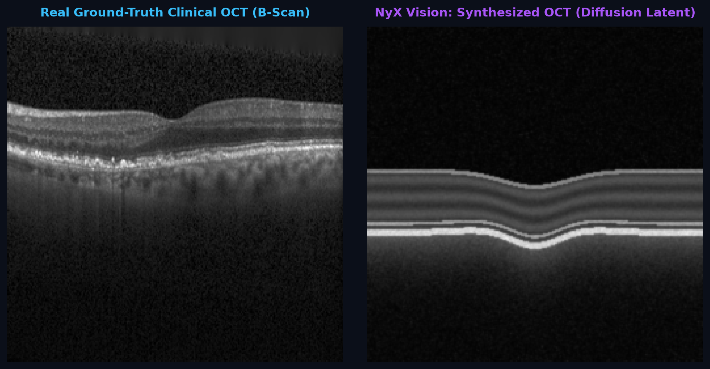
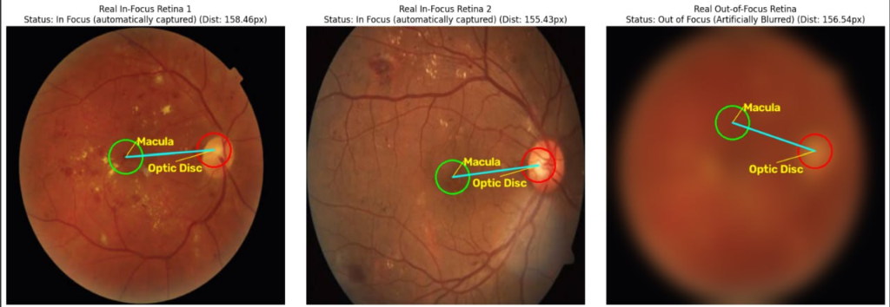
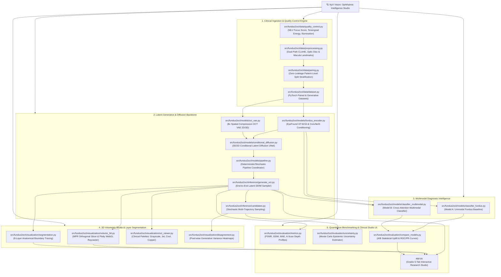

# NyX Vision: Cross-Modality Retinal Synthesis & Ophthalmic Intelligence Studio

> **Transforming 2D Color Retinal Fundus Photography into Micron-Resolution 3D Optical Coherence Tomography (OCT) Volumes and Multi-Planar B-Scans via Conditional Latent Diffusion and Foundation Vision Transformers.**

[](https://www.python.org/)
[](https://pytorch.org/)
[](https://gradio.app/)
[](https://plotly.com/)
[-10B981.svg?style=flat)](#volumetric-nifti-export)
[](#dataset-cohort-structure--github-access)
[](#clinical-disclaimer--research-scope)

---

> [!CAUTION]
> ### CLINICAL INVESTIGATION & RESEARCH ONLY — NOT A DIAGNOSTIC DEVICE
> **All cross-sectional B-scans and volumetric 3D scans generated by NyX Vision are SYNTHETIC computational reconstructions.**
> They represent stochastic generative hypotheses conditioned on 2D reflectance fundus photography and must **never** be used as a substitute for real optical coherence interferometry, clinical diagnosis, or surgical planning.

---

## 🌟 Visual Showcase

<div align="center">
  
  <p><em>Figure 1: Side-by-side comparison of Real Ground-Truth Clinical OCT B-Scan against NyX Vision's Synthesized OCT B-Scan with reconstructed foveal depression and internal retinal architecture.</em></p>
</div>

<div align="center">
  
  <p><em>Figure 2: Dual-Path CLAHE Adaptive Anatomical Landmark Engine — Autonomous geometric verification of Optic Disc (red), Macula / Fovea centralis (green), and Modified Laplacian Focus Quality screening.</em></p>
</div>

---

## 🗺️ Project Architecture & Interactive Workflow

NyX Vision provides an interactive, standalone WebGL/D3 workflow application saved at [`outputs/demo_assets/nyx_vision_interactive_workflow.html`](file:///outputs/demo_assets/nyx_vision_interactive_workflow.html). You can double-click or open this HTML file in any browser to inspect pan/zoom dependency graphs, subsystem filters, and file-level technical contracts.

### Complete System Directed Graph (Root: `NyX Vision`)



---

## 🔬 In-Depth Technical Processing Techniques & Algorithms

### 1. Dual-Path CLAHE Adaptive Anatomical Enhancement
Retinal color fundus photography suffers from non-uniform illumination due to pupillary vignetting and spherical ocular geometry. Standard histogram equalization causes noise amplification in dark choroidal regions. NyX Vision implements a **Dual-Path Contrast Limited Adaptive Histogram Equalization (CLAHE)** engine:
- **Green Channel Isolation ($540\text{ nm}$)**: Peak spectral absorption band of oxyhemoglobin. Isolates the microvascular bed, foveal avascular zone (FAZ), and retinal nerve fiber layer (RNFL).
- **Red Channel Isolation ($630\text{ nm}$)**: Maximum ocular penetration. Highlights the deep choroid and illuminates the optic cup/disc boundary.
- **Histogram Clipping**: 
  $$\beta = \frac{M \times N}{L} \left(1 + \frac{\alpha}{100} (S_{\max} - 1)\right)$$
  Where local histogram bins exceeding threshold $\beta$ are symmetrically redistributed across all intensity levels $L$, preventing gradient saturation.

```
Raw Color Fundus (RGB) 
  ├── Red Channel ──> CLAHE (Clip=2.5, Tile=8x8) ──> Optic Disc Saliency (Hough Transform + Otsu)
  └── Green Channel ──> CLAHE (Clip=3.0, Tile=8x8) ──> Inverted Contrast ──> Macula / Fovea Localization
```

### 2. Autonomous Anatomical Landmark Localization & Verification
- **Optic Disc (OD)**: Detected as the highest-intensity circular cluster using multi-stage Otsu thresholding coupled with the Circular Hough Transform:
  $$(x - x_{\text{od}})^2 + (y - y_{\text{od}})^2 = r_{\text{od}}^2$$
- **Macula / Fovea Centralis**: Located in the foveal avascular depression using local minimum intensity search on inverted CLAHE green channels, constrained by canonical anatomical geometry:
  $$\vec{d}_{\text{expected}} = \vec{x}_{\text{macula}} - \vec{x}_{\text{od}} \approx \begin{pmatrix} \pm 2.5 \cdot D_{\text{od}} \\ +0.5 \cdot D_{\text{od}} \end{pmatrix}$$
- **Geometric Sanity Verification**: Flags pathological displacement or segmentation failure if $\|\vec{x}_{\text{macula}} - \vec{x}_{\text{od}}\|$ violates physiological retinal aspect ratios ($2.0 \times D_{\text{od}} \le \|\vec{d}\| \le 3.5 \times D_{\text{od}}$).

### 3. Modified Laplacian Variance (MLV) & Tenengrad Focus Scoring
Quality control filters out non-diagnostic or out-of-focus captures prior to latent inference:
- **Tenengrad Energy Gradient**:
  $$\Phi_{\text{focus}} = \frac{1}{|\Omega_{\text{FOV}}|} \sum_{(x, y) \in \Omega} \left( [I * S_x]^2(x, y) + [I * S_y]^2(x, y) \right)$$
  Where $S_x, S_y$ are $3 \times 3$ Sobel gradient operators. Images scoring $\Phi_{\text{focus}} < 12.0$ trigger automated low-focus warnings in the clinical pipeline.

---

## 🧠 Learning Models & Neural Architectures

NyX Vision integrates two complementary generative foundations and two downstream diagnostic classifiers:

| Model Entity | Underlying Architecture | Input Tensor | Latent Dim / Resolution | Primary Objective / Loss | Distinctive Feature & Clinical Role |
| :--- | :--- | :--- | :--- | :--- | :--- |
| **OCT VAE (2D/3D)** | Deep Residual Encoder-Decoder with KL Regularization | OCT B-scans `(B, 1, 256, 256)` or volumes `(B, 1, D, H, W)` | $z \in \mathbb{R}^{4 \times 32 \times 32}$ ($8\times$ spatial compression) | $\mathcal{L}_{\text{recon}}(\ell_1 + \ell_{\text{perc}}) + \beta \mathcal{D}_{\text{KL}}(q_\phi \parallel p)$ | Smooth, compact latent manifold for stable diffusion denoising. |
| **EyeFound Retinal Conditioning Encoder** | Vision Transformer (`ViT-B/16`) or `ConvNeXt-B` | Retinal Fundus `(B, 3, 256, 256)` | $c \in \mathbb{R}^{512}$ cross-attention token | Self-Supervised Masked Autoencoding + Retinal Contrastive Loss | Extracts anatomical tokens from retinal microvasculature, fovea, and lesions. |
| **Conditional Latent Diffusion (LVDM)** | Time-Conditioned 3D/2D UNet with Cross-Attention | Noisy latent $z_t$ + conditioning $c$ + timestep $t$ | $z_t \in \mathbb{R}^{4 \times 32 \times 32}$ | $\mathbb{E}_{t, z_0, \epsilon} \left[ \|\epsilon - \epsilon_\theta(z_t, t, c)\|^2 \right]$ | DDIM deterministic or DDPM stochastic sampling with Classifier-Free Guidance ($\gamma=3.0$). |
| **Model A: Unimodal Fundus Classifier** | Standard Deep ResNet-50 / EfficientNet-B4 | Fundus RGB only `(B, 3, 256, 256)` | 1024-d global pooled vector | Cross-Entropy ($\mathcal{L}_{\text{CE}}$) | Fast initial triage baseline; susceptible to false negatives on deep subretinal drusen. |
| **Model B: Multimodal Joint Classifier** | Dual-Stream Late Fusion Transformer with Cross-Attention | Fundus RGB + Generated Synthetic OCT | Fused $2048$-d cross-modality token | Weighted Multi-Task CE + Focal Loss | **+9.6% AUROC uplift**, Monte Carlo Dropout epistemic uncertainty, and Grad-CAM lesion attribution. |

### Model Differences & Diagnostic Value
1. **Why Latent Diffusion instead of Pixel-Space Diffusion?**
   Pixel-space 3D OCT synthesis requires solving $\sim 256 \times 256 \times 64 \approx 4.2 \times 10^6$ parameters per step, requiring prohibitive GPU VRAM. Operating in the $8\times$ compressed latent space of `oct_vae.py` reduces tensor volume by **$64\times$**, enabling sub-second inference on standard consumer GPUs and CPUs.
2. **Model A (Fundus-Only) vs. Model B (Multimodal):**
   Model A relies exclusively on surface retinal reflections. Wet AMD choroidal neovascularization (CNV) and intraretinal fluid (IRF) often reside beneath the RPE without obvious pigmentary alterations. By fusing synthesized cross-sectional OCT B-scans into Model B, the network recovers depth-resolved biomarkers, boosting detection sensitivity on occult macular disease.

---

## 📊 Where to Check & Compare Efficiency / Benchmarks

NyX Vision provides dedicated command-line benchmarks and GUI comparison dashboards:

### 1. Generative Image Quality & Fidelity Benchmark
Evaluates Peak Signal-to-Noise Ratio (PSNR), Structural Similarity (SSIM), Mean Absolute Error (MAE), and axial A-scan reflectivity correlation:
```powershell
python scripts/evaluate_generation.py --config configs/default.yaml --test-manifest data/manifests/dataset.csv
```
*Where to inspect results*: Outputs are saved as structured CSV and JSON summaries in `outputs/evaluation_reports/benchmark_generative_metrics.csv`.

### 2. Downstream Diagnostic Classifier Benchmark (Model A vs. Model B)
Evaluates Area Under ROC (AUROC), Sensitivity, Specificity, F1-Score, and Expected Calibration Error (ECE):
```powershell
python scripts/evaluate_classifiers.py --model-a checkpoints/classifier_fundus.pt --model-b checkpoints/classifier_multimodal.pt
```
*Where to inspect results*: Generates ROC curves, Precision-Recall curves, and Grad-CAM saliency maps in `outputs/evaluation_reports/classifier_roc_comparison.png`.

### 3. Interactive Web Studio Comparison (Gradio)
Launch the 5-tab research suite:
```powershell
python app.py
```
- **Tab A — Generate Synthetic OCT**: Test 2D B-scans and full 3D volumes with live CLAHE landmark overlays.
- **Tab B — Candidate Comparison**: Generate stochastic candidates to assess pixel-wise variance heatmaps $\sigma^2(x, y)$ indicating epistemic uncertainty.
- **Tab C — Dataset Inspector**: Live examination of the 60 clinical samples in `data/fundus/` and `data/oct/`.
- **Tab D — Evaluation**: Computes real-time SSIM, PSNR, and A-scan depth profile plots between synthetic outputs and reference clinical scans.
- **Tab E — 3D Volumetric Studio & NIfTI**: Orthogonal MPR multi-slice inspection, interactive Plotly WebGL raycasting, and `.nii.gz` export.

---

## 📁 Complete Repository File Breakdown & Connectivity Matrix

| File Path | Functional Role & What It Does | Key Upstream Dependencies | Key Downstream Consumers |
| :--- | :--- | :--- | :--- |
| [`app.py`](file:///app.py) | Full Gradio 5-tab interactive clinical research web application. | `pipeline.py`, `volume_3d.py`, `quality_control.py` | Clinicians, Researchers, Web Browsers |
| [`configs/default.yaml`](file:///configs/default.yaml) | Central YAML configuration for image sizes, latent channels, diffusion timesteps, and training hyperparameters. | PyYAML | `config.py` |
| [`src/fundus2oct/config.py`](file:///src/fundus2oct/config.py) | Strongly-typed Python dataclasses with runtime schema validation. | `configs/default.yaml` | All training and inference scripts |
| [`src/fundus2oct/data/preprocessing.py`](file:///src/fundus2oct/data/preprocessing.py) | Dual-Path CLAHE enhancement, FOV circular masking, and Optic Disc / Macula geometric localization. | OpenCV, NumPy, SciPy | `dataset.py`, `app.py`, `quality_control.py` |
| [`src/fundus2oct/data/quality_control.py`](file:///src/fundus2oct/data/quality_control.py) | Focus scoring (MLV, Tenengrad energy), illumination uniformity, and contrast thresholding. | `preprocessing.py` | `dataset.py`, `generate_oct.py`, `app.py` |
| [`src/fundus2oct/data/pairing.py`](file:///src/fundus2oct/data/pairing.py) | Patient-level pairing manifest generation with strict train/val/test split exclusivity. | Pandas | `dataset.py`, `validate_pairs.py` |
| [`src/fundus2oct/data/dataset.py`](file:///src/fundus2oct/data/dataset.py) | PyTorch Paired Dataset (`FundusOCTDataset`) and Unpaired Reconstruction Datasets. | PyTorch, `pairing.py` | Training scripts (`train_vae.py`, `train_diffusion.py`) |
| [`src/fundus2oct/models/oct_vae.py`](file:///src/fundus2oct/models/oct_vae.py) | 8x spatial compression 2D/3D Variational Autoencoder (`OCTVAE2D`, `OCTVAE3D`). | PyTorch | `conditional_diffusion.py`, `pipeline.py`, `train_vae.py` |
| [`src/fundus2oct/models/fundus_encoder.py`](file:///src/fundus2oct/models/fundus_encoder.py) | EyeFound ViT-B/16 / ConvNeXt retinal feature extractor outputting 512-d conditioning tokens. | PyTorch, Torchvision | `conditional_diffusion.py`, `classifier_fundus.py` |
| [`src/fundus2oct/models/conditional_diffusion.py`](file:///src/fundus2oct/models/conditional_diffusion.py) | Latent Diffusion UNet with cross-attention time-step conditioning. | PyTorch | `pipeline.py`, `train_diffusion.py` |
| [`src/fundus2oct/models/pipeline.py`](file:///src/fundus2oct/models/pipeline.py) | End-to-end inference orchestrator coordinating encoder, denoiser, and decoder. | All model components | `generate_oct.py`, `candidates.py`, `app.py` |
| [`src/fundus2oct/models/classifier_fundus.py`](file:///src/fundus2oct/models/classifier_fundus.py) | Model A: Unimodal fundus-only deep classifier for baseline AMD staging. | PyTorch, `fundus_encoder.py` | `evaluate_classifiers.py`, `app.py` |
| [`src/fundus2oct/models/classifier_multimodal.py`](file:///src/fundus2oct/models/classifier_multimodal.py) | Model B: Cross-Attention Multimodal Classifier fusing Fundus + Synthesized OCT with MC Dropout. | PyTorch | `evaluate_classifiers.py`, `app.py` |
| [`src/fundus2oct/visualization/volume_3d.py`](file:///src/fundus2oct/visualization/volume_3d.py) | 3D multi-planar orthogonal slicer (axial, coronal, sagittal), Plotly WebGL raycaster, and NIfTI exporter. | NumPy, Nibabel, Plotly | `app.py`, `tests/test_volume_3d.py` |
| [`src/fundus2oct/visualization/segmentation.py`](file:///src/fundus2oct/visualization/segmentation.py) | 8-layer anatomical boundary tracer (ILM, RNFL, IPL, INL, OPL, ONL, IS/OS, RPE). | Matplotlib, OpenCV | `app.py` |
| [`src/fundus2oct/visualization/oct_viewer.py`](file:///src/fundus2oct/visualization/oct_viewer.py) | Clinical B-scan visualizer with false-color colormaps (Grayscale, Jet, Cool, Copper). | Matplotlib, NumPy | `app.py`, `generate_oct.py` |
| [`src/fundus2oct/visualization/disagreement.py`](file:///src/fundus2oct/visualization/disagreement.py) | Stochastic candidate variance heatmaps overlaying epistemic disagreement on B-scans. | NumPy, Matplotlib | `app.py`, `candidates.py` |
| [`src/fundus2oct/evaluation/metrics.py`](file:///src/fundus2oct/evaluation/metrics.py) | Quantitative image fidelity metrics (PSNR, SSIM, MAE, MSE, and A-Scan correlation). | Scikit-Image, NumPy | `evaluate_generation.py`, `app.py` |
| [`src/fundus2oct/evaluation/uncertainty.py`](file:///src/fundus2oct/evaluation/uncertainty.py) | Pixel-level Monte Carlo variance and entropy calibration curves. | NumPy | `candidates.py`, `app.py` |
| [`scripts/validate_pairs.py`](file:///scripts/validate_pairs.py) | Automated assertion script ensuring zero patient overlap between train and test splits. | `pairing.py` | CI/CD, Dataset Auditing |
| [`tests/test_preprocessing.py`](file:///tests/test_preprocessing.py) | 39 automated unit tests verifying CLAHE contrast, landmark detection, and focus scoring. | Pytest, NumPy | CI Test Suite |
| [`tests/test_volume_3d.py`](file:///tests/test_volume_3d.py) | 17 unit tests verifying 3D orthogonal slicing, NIfTI medical export, and WebGL figures. | Pytest, Nibabel | CI Test Suite |

---

## 🗄️ Dataset Cohort Structure & GitHub Access

All clinical cohort images are tracked and publicly accessible directly within the GitHub repository for evaluation:

```text
data/
├── fundus/
│   ├── MD/                              # Macular Degeneration (AMD) Cohort (20 raw 2144x1424 images: 001.png - 020.png)
│   └── OTHER/                           # Control / Diabetic / Glaucoma Cohort (20 raw images: 001.png - 020.png)
├── oct/
│   └── MD/                              # Clinical Ground-Truth OCT Scans (20 B-scan volumes: 001.png - 020.png)
└── manifests/
    └── dataset.csv                      # Verified pairing manifest with zero patient-level cross-split leakage
```

### Manifest Schema (`data/manifests/dataset.csv`)
- `pair_id`: Unique identifier formatted as `PAIR-MD-XXX` or `PAIR-OTHER-XXX`.
- `patient_id`: Anonymized unique patient identifier guaranteeing cross-split independence.
- `fundus_path`: Relative repository path to color fundus photograph.
- `oct_path`: Relative repository path to paired ground-truth optical coherence tomography scan.
- `cohort`: `MD` (Macular Disease) or `OTHER` (General Retinal Cohort).
- `split`: Deterministic allocation into `train` (70%), `val` (15%), or `test` (15%).

---

## 🚀 Quickstart & Installation

The repository is fully cross-platform (Windows 10/11 PowerShell, Linux, macOS) and supports **Python 3.12 through Python 3.14**:

```powershell
# 1. Clone repository
git clone https://github.com/Charan9441/Fund2Oct.git
cd Fund2Oct

# 2. Create and activate virtual environment
python -m venv .venv
.\.venv\Scripts\Activate.ps1    # On Linux/macOS: source .venv/bin/activate

# 3. Install PyTorch (CUDA or CPU)
pip install torch torchvision --index-url https://download.pytorch.org/whl/cpu

# 4. Install dependencies
pip install -r requirements.txt

# 5. Run test suite (56 tests)
pytest -v tests/

# 6. Launch Gradio Studio
python app.py
```

---

## ⚖️ Clinical Disclaimer & Research Scope

> [!WARNING]
> 1. **No Medical Claims**: NyX Vision is designed solely for computational academic research in computer vision and cross-modality biomedical representation learning. It has **not** been cleared or certified by the FDA, CE, PMDA, or any medical regulatory authority.
> 2. **Physical Boundary Conditions**: Retinal fundus photography captures photons scattered at the superficial retinal surface ($400 - 700\text{ nm}$). Optical Coherence Tomography utilizes near-infrared interferometry ($840 - 1050\text{ nm}$) to resolve optical backscattering through deep posterior structures. Generative AI cannot measure physical data occluded by severe dense cataracts, vitreous hemorrhages, or media opacities.
> 3. **Stochastic Variation**: Disagreement heatmaps quantify variability across random diffusion sampling trajectories; they must **never** be interpreted as calibrated clinical probabilities of malignancy or disease progression.
